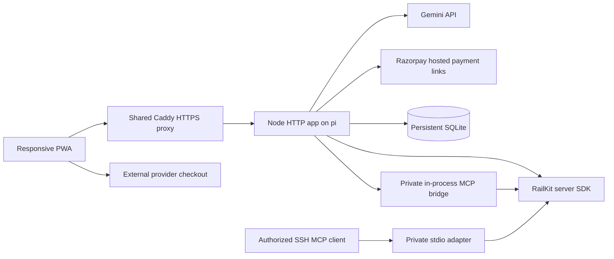

# Architecture and data handling

## Request flow

The PWA is static HTML, CSS and JavaScript with same-origin JSON APIs. Pi uses Docker Compose project `aibooking`, an app volume for SQLite and the existing Caddy proxy. The app container runs as a non-root user with a read-only filesystem; its data volume is writable. DNS and wildcard TLS are maintained separately from application releases.

Rail requests are validated using the shared service schemas before entering `railkit@6.0.0`. The app converts ISO dates into the SDK date format. Provider calls have a 20-second deadline. Errors are sanitized; neither another provider nor historical cached rail data is currently substituted. A successful HTTP response identifies RailKit and the retrieval time, which is not a guarantee of upstream observation freshness.

## Assistant and MCP

The assistant validates request size, history and obvious sensitive identifiers, then selects catalog-bound actions. Fully specified non-PNR rail queries can use the private MCP bridge to fetch data for an explanation. Responses from the browser are not accepted as verified rail results; the server retrieves them again.

The adapter exposes fourteen read-only tools, excluding PNR. It uses the official MCP SDK and the same RailKit integration, so it does not add an independent data source. There is no public `/mcp` endpoint. External clients use authenticated SSH and stdio, as described in the [MCP guide](../deploy/MCP.md).

Gemini can have one bounded fallback model attempt on transient failures. Each model attempt consumes the daily budget, including failed attempts. If a verified rail result exists but model explanation fails, the response can retain the result with a deterministic RailKit explanation. Provider data and AI output are not booking confirmations.

## Stored data

| Data | Location and behavior |
| --- | --- |
| Saved service shortcuts | Browser local storage; service/provider identifiers, not tickets |
| Chat history | Browser memory and submitted request history; not saved to application SQLite |
| AI usage | SQLite `ai_daily`: IST date, attempts, successes and reported token totals |
| Referral counts | SQLite `clicks`: day, provider, source and count; no stored visitor identity |
| Commercial placements | SQLite `placements`: provider, approved destination URL and disclosure flags |
| Business enquiries | SQLite `leads`: company, email, message, consent, status and timestamps |
| Payment requests | SQLite `payment_requests`: agreed amount/description, mode, capability reference, provider link ID, state and timestamps; no wallet balance |
| PNR query/results | Sent to RailKit for the dedicated lookup; not saved in app SQLite or the service worker |
| API keys and admin token | Protected server environment; excluded from Git and browser bundles |

Without `DATA_DIR`, SQLite is in memory and its contents disappear on restart. Pi stores `/app/data/aibooking.sqlite` in `aibooking_app_data`. The schema initializes on startup; there is no versioned migration framework.

Enquiry retention has no automatic deletion job. Operators must define retention and deletion procedures before expanding collection. Google and rail providers receive the data needed by their respective requests; their retention behavior is outside this app's storage controls. Avoid logging full URLs or request bodies: PNR uses a GET query and can appear in browser/network tooling and any separately enabled proxy access logs.

## Security and operational limits

- Main-page CSP restricts scripts to the app. The opt-in Skyscanner iframe page has its own third-party allowlist.
- Admin APIs require a constant-time-checked bearer token; this is a shared operator credential, with no individual user accounts or roles.
- Commercial redirects resolve known provider IDs and validated hosts. Affiliate/sponsored placements require disclosure; click counts are not sales or revenue.
- AI and commerce use in-memory per-address limits; AI additionally has a persistent daily allowance. Public rail limiting uses the direct socket address, so the shared proxy currently creates a shared 20-request/minute bucket.
- In-memory limits reset on restart and do not coordinate across replicas. The design currently assumes one app instance.
- There are no ticket issuance APIs, stored-value balances, AP2 financial mandates, refunds, user ticket history, seat holds or guaranteed booking actions.

See [operations](OPERATIONS.md) for troubleshooting and [development](DEVELOPMENT.md) for configuration.

Optional hosted checkout for agreed AIBooking service requests is documented in [Wallet & payments](PAYMENTS.md). It does not fund third-party booking handoffs.
